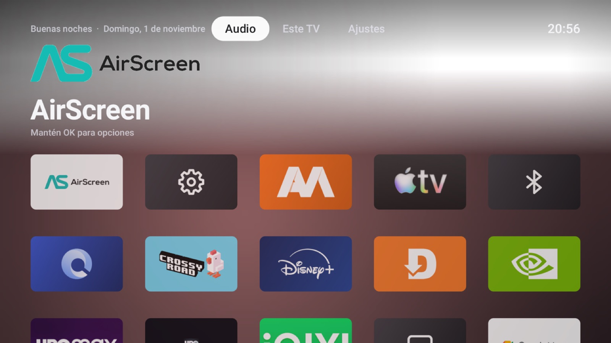
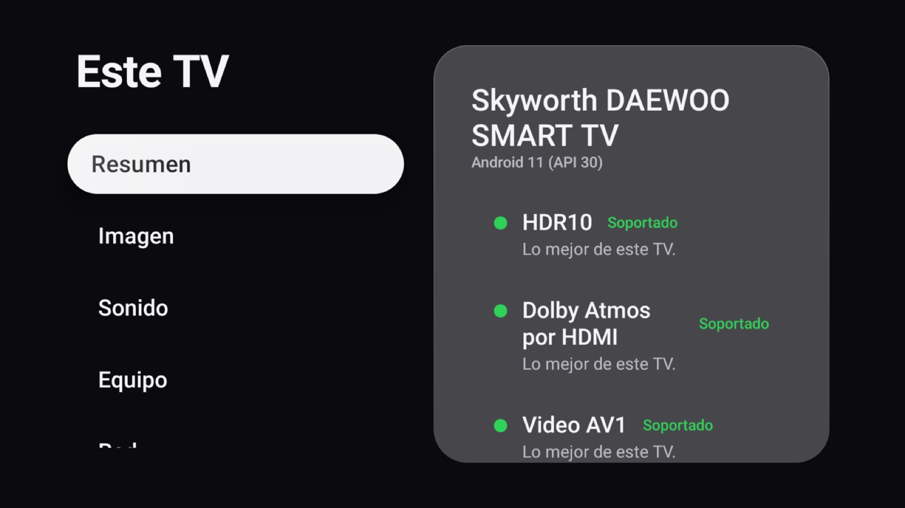

# Hogar · tu Google TV con alma de Apple TV

Hogar es una app libre para **Google TV / Android TV** que reemplaza la pantalla de inicio por una
inspirada en tvOS y le suma lo que a un televisor Android le falta para convivir con equipos Apple:
**AirPlay de entrada y de salida, multiroom con HomePod, un puntero para apps táctiles, un navegador
para el control remoto** y una pantalla que te dice, sin adornos, qué puede y qué no puede hacer tu TV.

No hace falta root ni tocar el firmware. Se instala como cualquier app y se desinstala sin dejar rastro.

| Inicio | Este TV |
|---|---|
|  |  |

## Qué trae

- **Pantalla de inicio estilo tvOS**: cuadrícula de iconos 5:3 con el logo real de cada app (en capas y
  con efecto parallax), Top Shelf, Centro de control y animaciones con los resortes de Apple. Va a
  60 cuadros por segundo en un TV de gama media (medido) y nunca estira una imagen: todo se dibuja a su
  tamaño real.
- **Botón Inicio propio**: Google TV no deja elegir otra pantalla de inicio; Hogar lo resuelve con su
  propio servicio de accesibilidad, sin desactivar nada de fábrica.
- **Este TV**: detecta en cualquier televisor el chip, la memoria, el panel (4K real aunque la interfaz
  sea 1080p), HDR10/HLG/HDR10+/Dolby Vision, AV1/HEVC/VP9, Dolby Atmos por HDMI, Widevine, lossless y
  Wi-Fi, y lo explica en lenguaje simple. Lo que Android no informa se dice tal cual.
- **AirPlay hacia HomePod y altavoces AirPlay** (emisor propio): audio sin pérdida bit a bit
  (ALAC/PCM 16 bits/44,1 kHz), pares estéreo y prueba automática tras cada actualización de Apple.
- **Receptor AirPlay** ("TV como receptor"): duplicar pantalla desde iPhone, iPad y Mac, recibir música y
  videos enviados (Fotos, Safari).
- **TV como puente multiroom**: lo que mandas por AirPlay al TV se reenvía sincronizado a tus HomePod
  mientras suena también en el TV.
- **Reproductor sin pérdida** de archivos FLAC/ALAC/WAV y captura del sonido del TV.
- **Modo puntero** para apps hechas para celular (por ejemplo Apple Music instalada a mano): un puntero
  estilo iPad que se mueve con las flechas y pulsa con OK. Funciona aunque el TV no tenga pantalla táctil.
- **Navegador** estilo Safari para el control remoto (Android TV no tiene Chrome).
- **Reproduciendo ahora** al estilo Apple Music para la app que esté sonando (Apple Music, Spotify,
  YouTube Music…): fondo animado con los colores de la carátula que late con la música, letra
  sincronizada con resaltado por palabra cuando existe, cola "A continuación", carátula en alta
  resolución (catálogos públicos de Apple y Deezer) e insignias de calidad solo cuando son verificables.
- **Luz nocturna** para todo el TV, en cualquier app: intensidad graduable, horario fijo o del
  atardecer al amanecer calculado en el propio TV (Caracas por defecto, se elige la ciudad).
- **Iluminación sincronizada** con lámparas Govee por la red local (API LAN): la lámpara toma la paleta
  de la carátula y, si quieres, late con el ritmo.
- **HomeKit y Siri**: Hogar se presenta en la app Casa como un accesorio "Televisión". Desde iPhone,
  iPad, Mac, Apple Watch o HomePod: "Oye Siri, apaga el televisor", "pon Netflix en el televisor",
  volumen, control remoto del Centro de control y automatizaciones de Casa junto al resto de la casa.
  Se empareja con el código o el QR que muestra Hogar (Centro de control → HomeKit). Encender por Siri
  funciona si el TV mantiene la red en reposo (muchos Google TV lo hacen con el "reposo rápido").
- **Control remoto aprovechado**: Inicio, ⚙️/👤 abren el Centro de control y 📺 abre Reproduciendo ahora.
- **Tipografía**: usa San Francisco si la pones en `fonts-local/` (uso personal; su licencia no permite
  redistribuirla) y si no, Inter, incluida en el repositorio.

## Lo que no se puede (y por qué)

Esto lo comprobamos con evidencia antes de rendirnos. Si encuentras una vía, abre un issue.

| Deseo | Estado | Motivo |
|---|---|---|
| Interfaz a 4K nativo | ❌ en la mayoría de los TV | Muchos chips (MStar/MediaTek) dan a las apps una capa gráfica de 1080p; el video sí va en 4K. *Este TV* te dice cuál es tu caso. A 2,6 m de un TV de 65" un píxel 1080p ya no se distingue. |
| El TV como "televisor Matter" en Casa | ❌ | La app Casa no muestra televisores Matter como televisor; por eso Hogar usa HomeKit directo. |
| Multiroom de AirPlay 2 desde el iPhone (agrupar el TV con HomePods) | ❌ sin root | Requiere el reloj PTP en los puertos UDP 319/320 y Android no deja a las apps usar puertos < 1024. Por eso existe el "puente". |
| Dolby Atmos por AirPlay | ❌ | Apple solo envía Atmos por AirPlay a sus equipos (Apple TV, HomePod). |
| Dolby Atmos con Apple Music en el TV | ⚠️ depende del TV | Apple Music solo muestra Atmos en equipos certificados; además hace falta una barra Atmos por HDMI ARC. |
| Videos con DRM enviados por AirPlay (Netflix, Apple TV+) | ❌ | Usan FairPlay Streaming, exclusivo de Apple. |
| Root "seguro" | ❌ en TV con arranque bloqueado | Sin desbloqueo oficial y sin firmware publicado para restaurar, el riesgo de dejar el TV inservible es real. |

## Instalación

Necesitas un computador con [Android platform-tools](https://developer.android.com/tools/releases/platform-tools) (`adb`) en la misma red Wi-Fi que el TV.

1. En el TV: **Ajustes → Sistema → Información → pulsa "Compilación" 7 veces**.
2. **Ajustes → Sistema → Opciones de desarrollador → activa "Depuración USB"** (en muchos TV eso abre
   también la depuración por red, puerto 5555) o "Depuración inalámbrica".
3. Descarga `hogar.apk` desde [Releases](../../releases) (o compílalo, ver abajo) y ejecuta:

```bash
./scripts/instalar.sh            # busca el TV en la red
./scripts/instalar.sh 192.168.1.50 hogar.apk
```

4. Acepta el aviso "¿Permitir depuración?" en el TV con **Permitir siempre**.

El instalador revisa la versión de Android, instala la app y activa sus permisos (accesibilidad para el
botón Inicio y el puntero, lector de notificaciones para *Reproduciendo ahora*, superposición para el
receptor AirPlay). Requisito: Android 10 (API 29) o superior.

> Si "fuerzas la detención" de Hogar, Android apaga su servicio de accesibilidad y el botón Inicio vuelve
> a Google TV. Hogar te muestra un botón para reactivarlo.

**Desinstalar:** `adb uninstall live.hogar`.

## Compilar

```bash
git clone https://github.com/sebaslobo22/hogar-tv && cd hogar-tv
echo "sdk.dir=/ruta/a/android-sdk" > local.properties
./gradlew assembleRelease testDebugUnitTest
```

JDK 17. El APK queda en `app/build/outputs/apk/release/`.

## Cómo está hecho

| Módulo | Qué hace |
|---|---|
| `app` | Actividad principal y navegación entre pantallas. |
| `design` | Sistema de diseño: tokens, resortes de Apple, vidrio sin blur en tiempo real, foco tvOS, iconos vectoriales propios. |
| `launcher` | Pantalla de inicio, tarjetas por marca, Centro de control, servicio de accesibilidad (botón Inicio y modo puntero). |
| `specs` | *Este TV*: sondeo del hardware y veredictos en lenguaje simple. |
| `airplay` | Emisor AirPlay (emparejamiento HAP transitorio, RTSP cifrado, RTP, ALAC). |
| `receiver` | Receptor AirPlay (duplicar pantalla, audio, video). |
| `player` | Reproductor sin pérdida, captura del sonido del TV y puente multiroom. |
| `browser` | Navegador para control remoto. |
| `nowplaying` | Reproduciendo ahora, letra sincronizada, cola e iluminación Govee. |
| `homekit` | Servidor HomeKit (HAP sobre IP) propio: accesorio Televisión con entradas por app y volumen. |
| `core` | Contratos compartidos de audio. |

Rendimiento: las decisiones se midieron en un TV real de 4 núcleos y 1,8 GB (MStar m7332): fundidos
dibujados en una sola pasada, sombras horneadas, sin animaciones continuas ni shaders creados por cuadro.

## Créditos y licencia

- Receptor AirPlay portado de [UxPlay](https://github.com/FDH2/UxPlay) y RPiPlay (GPL-3.0), incluido
  *playfair*; detalle en [`receiver/NOTICE`](receiver/NOTICE).
- Emisor AirPlay basado en lo documentado por [pyatv](https://github.com/postlund/pyatv) y OwnTone.
- Decodificador ALAC portado del [ALAC de Apple](https://github.com/macosforge/alac) (Apache 2.0).
- Letras sincronizadas de [LRCLIB](https://lrclib.net); carátulas de la búsqueda pública de iTunes y de la API de Deezer.
- Tipografía [Inter](https://rsms.me/inter/) (SIL OFL 1.1, ver `design/src/inter/OFL-Inter.txt`).

Por incluir código GPL-3.0, todo el proyecto se distribuye bajo **GPL-3.0** ([LICENSE](LICENSE)).

Hogar no está afiliado a Apple ni a Google. AirPlay, HomePod, Apple TV, tvOS y Apple Music son marcas de
Apple Inc.; Google TV y Android TV, de Google LLC. Los logos de las apps se leen en tiempo de ejecución
de cada app instalada; el repositorio no incluye arte de marcas.

---

### English summary

Hogar is a free, root-less home screen for Google TV / Android TV inspired by tvOS: AirPlay sender
(lossless to HomePod) and receiver (screen mirroring), a multiroom bridge, a pointer mode for touch-only
apps, a remote-friendly browser, a capability report for any TV, and fullscreen Now Playing with synced
lyrics. Install with `./scripts/instalar.sh` (adb over the network). GPL-3.0.
